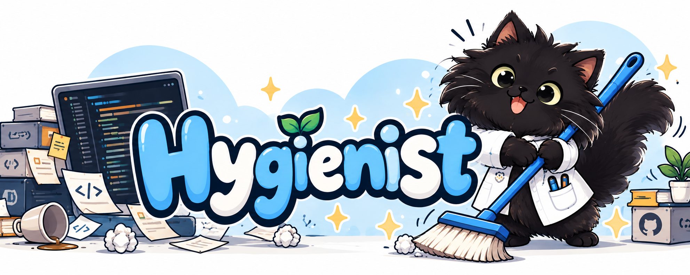

# Hygienist

Hygienist helps your AI coding agent keep an eye on the small repository details
that are easy to miss. Add project-specific checks once, then ask it to run them
when you want a quick health check—before a pull request, after a config change,
or whenever something feels easy to overlook.

## Safety

> [!WARNING]
> Rules are instructions followed by an agent with access to your project and
> its available tools. A malicious rule can request secret disclosure, network
> uploads, file deletion, or other destructive actions. Review third-party
> rules and any scripts they call before running them. Hygienist does not
> automatically inspect or filter rules, and does not provide its own security
> sandbox. The optional `inspect` operation can help you assess risk, but its
> report is advisory and cannot guarantee that a rule is safe.

## Install

With Node.js installed, you can install Hygienist using the
[skills CLI](https://github.com/vercel-labs/skills):

```sh
npx skills add cleg/hygienist --skill hygienist --global
```

Follow the installer prompts to choose your coding agents. The `--global` flag
makes the skill available across your projects. To select Codex and Goose
explicitly:

```sh
npx skills add cleg/hygienist --skill hygienist --global --agent codex goose
```

### Use a local checkout

If you're working on Hygienist itself, link the source skill directory into your
agent's skills directory so edits are available immediately. Replace
`/absolute/path/to/hygienist` with this repository's path. The distributable
skill is in `skills/hygienist/`; README, logo, and tests stay outside it.

```sh
# Codex
mkdir -p ~/.codex/skills
ln -s /absolute/path/to/hygienist/skills/hygienist ~/.codex/skills/hygienist

# Goose
mkdir -p ~/.agents/skills
ln -s /absolute/path/to/hygienist/skills/hygienist ~/.agents/skills/hygienist
```

If you already have a Hygienist installation, take a look before creating the
link so you don't replace it by accident. If the skill doesn't show up right
away, start a new agent session. In Goose, `goose skills list` can confirm
whether it's available.

## Use

Start your agent in the project you'd like it to help with, then ask in your
own words. For example:

| Goal | Example request |
| --- | --- |
| Set up Hygienist in a project | `Use $hygienist to init this project` |
| Add a project-specific check | `Use $hygienist to add-rule: verify that all environment variables are documented` |
| Edit an existing check | `Use $hygienist to edit-rule: make the environment example check read-only` |
| Review checks for risky instructions | `Use $hygienist to inspect this project` |
| Run the project's checks | `Use $hygienist to check repository hygiene` |

In Codex, invoke the skill with `$hygienist`. In Goose, use `/skills hygienist`
(the original MVP also supported `/skill hygienist`). With another agent, use
its usual skill invocation—or ask it to read Hygienist's installed instructions.

### Initialize

Initialization creates `.hygienist/` if it does not exist, then offers optional
starter checks. Choose any combination or none. If the directory already
exists, initialization leaves its contents alone; ask to add a rule instead.
Selected templates may install their declared supporting scripts into
`.hygienist/helpers/`. Initializing a project does not run checks or helpers.

### Add checks

Checks are Markdown files named `NN-name.md` in `.hygienist/`, where `NN` is a
number with at least two digits. Ask the agent to add a check in plain language;
it will clarify important details such as scope, pass/fail criteria, and
whether it may make repairs. Checks can use supporting scripts in
`.hygienist/helpers/`; the agent can create them when adding a check. Each rule
specifies its helper commands, inputs, outputs, error behavior, and allowed
changes. Existing helpers are reused only when their contents match; conflicting
files are not overwritten. Adding a check does not run it against the project.
New custom helpers can be verified separately on synthetic temporary inputs before installation.

### Edit checks

Ask to change an existing rule by path, name, or description. The agent clarifies
ambiguous choices, preserves project adaptations and unrelated behavior, checks
helper dependencies, and renumbers rules after editing. Compatible shared-helper
updates preserve every caller; incompatible changes use a new helper name for
the selected rule while keeping the old version. Changed custom helpers are
verified on synthetic temporary inputs.

Editing does not run the rule against your project. After a successful edit, the
agent offers to run it and mentions any permitted repairs; it waits for your
acceptance before executing. You can leave that offer unanswered or decline it
and the edit remains complete.

### Maintain helpers

Updating the global skill leaves installed project helpers and rules unchanged.
Ask for a deliberate migration when needed. The agent checks every dependent
rule before a compatible replacement; incompatible versions use a new helper
name and migrate only selected rules. Ordinary installation never overwrites a
conflicting copy. Removing a rule leaves its helpers in place; helper removal is
an explicit operation after confirming no remaining references. See the
[maintenance procedure](skills/hygienist/references/HELPERS.md).

### Review checks

`inspect` reads the project's rules and the local helper code they call, and
reports potentially risky behavior with paths, line numbers, and safer alternatives. Helper findings include the
calling rules; missing dependencies mean incomplete coverage. Supporting Markdown
in `helpers/` is distinguished from non-discovered checker tasks. It does not
execute rules or change files. The report is advisory: it cannot guarantee that a rule is safe,
and it does not automatically block a later run.

### Run checks

Ask the agent to run the checks when you want a repository hygiene review, such
as after a set of changes or before a commit. Each check runs independently and
returns `OK` or `FAIL`; the report includes the check path and its message. A
failed check does not prevent the remaining checks from running. If there are
no matching checks yet, Hygienist reports an empty result. You can start with a
template or add a rule that fits the project.

## A few possible workflows

Here are a few hypothetical ideas you could adapt into your own rules. Choose
checks that fit the way your project works.

- **Before opening a pull request:** ask Hygienist to look for unresolved
  conflict markers, accidentally committed OS files, or missing changelog
  entries.
- **After changing configuration:** add a rule to check that documented
  environment variables still match the settings the application reads.
- **When preparing a release:** ask for a check that verifies version numbers
  agree across the package metadata, CLI output, and release notes.
- **For a data or API project:** add a read-only check for required schema
  fields, migration naming, or compatibility notes.

These can be as lightweight as a reminder to inspect a file or as specific as a
clear pass/fail check. If you want a rule to make repairs, say which files it
may change when you ask the agent to create it.

## Starter checks

During initialization, you can choose from these optional templates:

| Check | What it does |
| --- | --- |
| [Environment example](skills/hygienist/templates/10-env-example.md) | Uses a Python helper to obtain only `.env` keys and clears example values. The agent must not read `.env` directly. It never changes `.env`; if `.env` is absent, it skips synchronization and audits an existing example for secrets. |
| [OS artifacts](skills/hygienist/templates/20-os-artifacts.md) | Adds common macOS, Windows, and Linux artifact patterns to `.gitignore`; suggests untracking indexed artifacts without removing them automatically. |
| [Conflict markers](skills/hygienist/templates/30-conflict-markers.md) | Reports unresolved merge markers and unmerged Git index entries without editing files. |

The first two templates can make limited repairs to project files. Have a look
at a template before choosing it, and review installed rules before asking your
agent to run them.

### Environment helper

The environment template installs the bundled
`skills/hygienist/templates/helpers/env-keys.py` as
`.hygienist/helpers/env-keys.py`. It needs Python 3 on a POSIX platform providing
`os.O_NOFOLLOW` and `os.O_NONBLOCK` (macOS or Linux), with no additional packages. Native Windows is
unsupported; use a compatible POSIX environment such as WSL. Missing required
flags fail with a controlled diagnostic, without reading `.env`:

```sh
python3 -I -B .hygienist/helpers/env-keys.py /absolute/path/to/project
```

The `-I` flag isolates imports from neighboring files, `PYTHONPATH`, and user
site packages; `-B` prevents bytecode cache writes. The checker verifies the
helper file and its parent directories before executing it: symlinks below the
declared `.hygienist` directory are rejected. A deliberately selected symlink
for `.hygienist` itself remains supported. Installation metadata in a rule is
for `init`/`add-rule`; a checker requires helpers to be installed already.

Successful output contains only `NAME=` lines, with no values or comments. The
helper supports comments, optional `export`, and quoted multiline values without
executing them or expanding variable references. It rejects duplicate keys,
symlinks, mixed quoting, backslash continuations, and other unsupported syntax.
Exit codes are `0` for success, `3` for an absent `.env`, `1` for read/parse
failure, and `2` for incorrect invocation. Errors never produce partial keys.
The helper never writes files. A missing or failed helper makes the check fail;
the agent must not substitute a direct read of `.env`.

The rule still reads and audits `.env.example`, and can make the documented
repairs. This boundary is an agent instruction, not an additional sandbox.
Helpers are supporting resources: discovery and renumbering apply only to the
numbered Markdown rules directly in `.hygienist/`.
